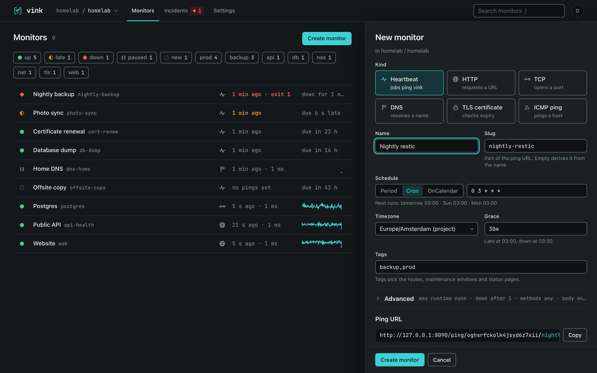
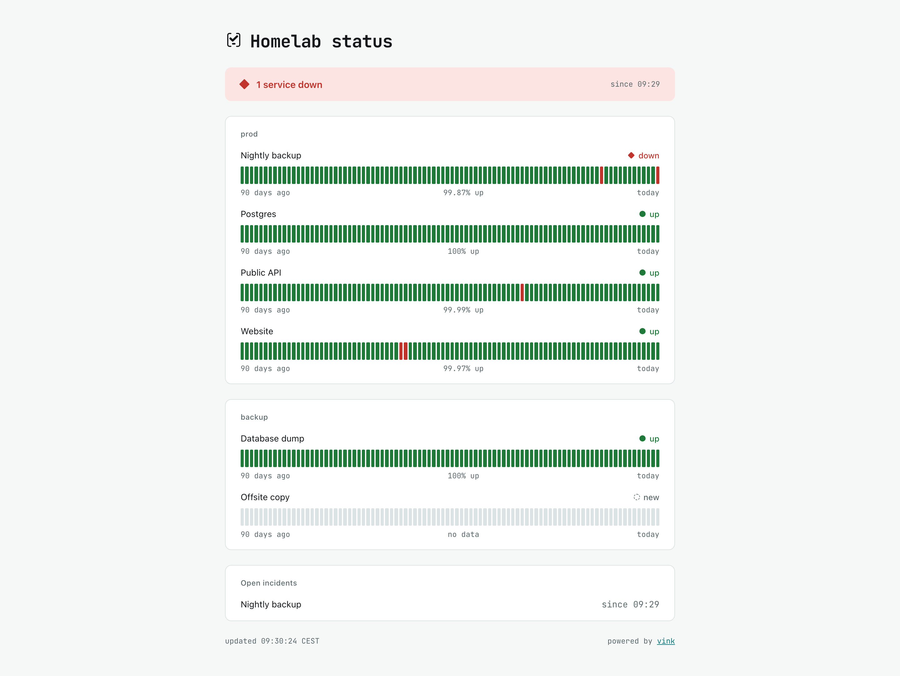

Every homelab and every company has them: the jobs that run at night. A backup at three, a database dump at four, a certificate renewal once a week, a sync script somebody wrote years ago and nobody dares to touch. They are the most important things nobody looks at.

When one of them breaks loudly, that is fine. It fails, it sends a mail, someone fixes it. The dangerous failure is the quiet one. The cron daemon did not come back after a reboot. Someone commented out the line "just for today". The disk filled up and the script died before it could complain. Nothing failed, so nothing alerted. A backup that stopped in March gets found in July, usually on the day you need it.

[vink](https://github.com/w4jnl/vink) is my answer to that. It turns the question around. Instead of waiting for a job to report a failure, it expects the job to report success, on schedule. When that report does not arrive, the silence itself is the alarm.

## The idea in one picture


%%{init: {"theme":"base","themeVariables":{"primaryColor":"#e3f4f5","primaryTextColor":"#14181A","primaryBorderColor":"#12999D","secondaryColor":"#fbe9d4","secondaryBorderColor":"#E8963C","tertiaryColor":"#eef1f1","tertiaryBorderColor":"#8A999C","lineColor":"#8A999C","textColor":"#14181A","nodeTextColor":"#14181A","clusterBkg":"#f3f6f6","clusterBorder":"#8A999C","titleColor":"#14181A","edgeLabelBackground":"#eef1f1","labelBackgroundColor":"#eef1f1","labelColor":"#14181A"}}}%%
flowchart LR
    J["backup.sh<br/>runs at 03:00"] -- "pings vink<br/>when it succeeds" --> Q{"ping arrived<br/>on time?"}
    Q -- "yes" --> U["● up<br/>nothing to do"]
    Q -- "no" --> L["◐ late<br/>from 03:00:30"]
    L -- "still nothing<br/>at 03:30" --> D["◆ down<br/>incident opened"]
    D --> A["alert on my phone<br/>with a one-click ack"]
    classDef up fill:#dff3e5,stroke:#5FC47A,stroke-width:2px,color:#14181A
    classDef late fill:#fbe9d4,stroke:#E8963C,stroke-width:2px,color:#14181A
    classDef down fill:#fde4e2,stroke:#F0645A,stroke-width:2px,color:#14181A
    class U up
    class L late
    class D down


The job runs and, when it succeeds, calls a URL. vink knows the job's schedule, so it knows when that call is due. A little after the deadline the monitor turns *late*. If nothing arrives before the grace period runs out, it turns *down*, opens an incident and tells me.

## What it looks like


Every monitor is one row: its state, its name, when it last checked in and when it is due next. The chips on top filter by state or by tag. A click on a row opens a drawer with the ping URL, the last 24 hours as a bar, and the recent check-ins, including what the job said when it failed.

The states are the whole language of the tool, and there are only five:

| glyph | state | what it means |
|---|---|---|
| `◌` | new | created, waiting for the first check-in |
| `●` | up | checked in on time, or the check passed |
| `◐` | late | past the deadline but inside the grace period, or a first failed check |
| `◆` | down | the grace is over, the job reported a failure, or a check keeps failing |
| `‖` | paused | switched off on purpose, no alerts |

Each state has its own shape as well as its own colour, so the list still reads for colour-blind eyes and on a black-and-white printout.

## How a job checks in

The simplest version is one extra line in the crontab: run the job, and if it succeeded, call the monitor's URL.

```cron
0 3 * * * /usr/local/bin/backup.sh && curl -fsS -m 10 --retry 3 https://vink.example.com/ping/<ping key>/nightly-backup
```

If the backup fails, `curl` never runs, the ping never arrives, and vink notices. That alone already beats finding out in July.

The nicer version uses vink's own command-line tool, which wraps the job:

```sh
vink run nightly-backup -- /usr/local/bin/backup.sh
```

It tells vink the job has started, runs it, and then reports how it ended: the exit code and the last part of the output. So when a job fails, the alert on my phone already says *why*. In the screenshot above that is restic complaining about a lock, so I know what to fix before I even open a laptop.

<figure>
  
  <figcaption>A failed backup, a successful re-run through <code>vink run</code>, and the monitor back to up.</figcaption>
</figure>

Because vink knows when a run started, it also catches the job that hangs instead of failing. Give the monitor a maximum runtime, and a run that never finishes counts as a failure. For programs rather than shell scripts there are tiny clients for Go and Python, both without dependencies, and a monitor can even create itself from the first ping of a new job.

A monitor knows its schedule: a fixed period, such as every hour, or a cron expression in its own timezone. The form spells out the next runs, so there is no guessing whether `0 3 * * *` means what you think it means.



Daylight saving time is handled too. On the night the clocks jump forward, a run time that does not exist is skipped instead of firing at a strange hour. On the night they go back, a time that happens twice fires once.

## It checks services as well

The other half of monitoring is the classic uptime check. Is the website up? Does the database port answer? Does the name still resolve? When does the certificate expire? vink does those too: HTTP with checks on the status code and the content, TCP, DNS, TLS certificate expiry and ping.

It is deliberately calm about it. A failed check is retried twice, five seconds apart, before it counts at all. One counted failure turns the monitor late, and only three in a row turn it down. A single hiccup in the night does not wake anyone.

The important part is that both halves feed the same states, the same incidents, the same alerts and the same status pages. That was the whole reason for building it.

## Telling the right people

When something goes down, vink tells me through whatever I happen to use. It supports email, ntfy push notifications, Gotify, Matrix, Slack-style webhooks and Alertmanager. Any other webhook works with a template, and templates for PagerDuty, Opsgenie, Discord and Telegram are included. Tags decide who hears about what: backups go to me, the production API goes to the team.

Every alert carries a link that acknowledges the incident in one click, without signing in. Until someone does, vink can repeat the alert at an interval. Patching on Sunday night? A maintenance window keeps the expected outage quiet, and the monitors are looked at again when it ends.

For everyone else there are public status pages:



They show a banner, the 90-day history of each service and the open incidents. They are plain HTML without any scripts, so they load fast, can sit on their own domain, and can ask for a password when they are not meant for the whole world. Small badges for a README or a wiki come with them.

## Why I built it

There are good tools for each half. [Healthchecks](https://healthchecks.io) is the reference for heartbeats, and vink borrows its URL style. It does not check services, by design. [Uptime Kuma](https://github.com/louislam/uptime-kuma) checks everything, but it is built for one user. [Gatus](https://github.com/TwiN/gatus) is configured from a file and has no users at all.

I needed both halves in one place, and for two very different homes. One is my homelab. The other is the closed corporate network, where nothing may phone home, people sign in through the company's single sign-on, and several teams share one installation without seeing each other's monitors.

## Choices that make it easy to live with

- **One program, one file.** vink is a single Go binary with the database built in. Backing it up means copying one file, plus the key file next to it, and there is a command that does it while the server keeps running.
- **Nothing leaves the network unless I configure it.** No telemetry, no update checks, no fonts from a CDN. For proof, vink can log every outgoing connection it makes, and on an idle install that log stays empty.
- **Agents for closed networks.** When the server cannot reach a network, a small agent inside it can. It is the same binary started as `vink agent`. It connects *out* to the server, so no firewall has to open a port inward, and it keeps nothing on disk.
- **Teams and sign-in.** Organisations, projects and four roles. People sign in through the company's identity provider, the reverse proxy that is already there, or a local account with two-factor, and an audit log records every change.
- **Configuration in git.** Monitors, channels, routes and status pages can live in a `vink.yaml` file. `vink apply` makes the server match it and `vink export` writes it back. There are importers for Healthchecks and Uptime Kuma too.
- **Works on a phone.** The web interface is plain server-rendered pages, and it works the same on a phone, a tablet and a wide monitor.

## The name

*Vink* is Dutch for finch. A *vinkje*, a little finch, is also what the Dutch call the tick on a checklist, which is exactly what a job does when it checks in.

vink is the younger sibling of [flok](/posts/flokagentsidebar/), my agent sidebar for tmux, and the logos say so. flok's mark is a terminal bracket holding a chevron, a bird in flight, and a cursor. In vink's mark the same bird has landed on the line and become a tick.

## Getting it

The quickest way is the container image:

```sh
docker run -d --name vink -p 8080:8080 -v vink-data:/data ghcr.io/w4jnl/vink
printf 'a-long-password\n' | docker exec -i vink /vink admin init --org homelab --user admin --password-stdin
```

The second command creates the first account, organisation and project, and prints the project's ping key and an API key; the API key is shown only this once. Then open http://localhost:8080, create a heartbeat and add its ping to the job. On macOS and Linux, `brew install w4jnl/tap/vink` installs the binary, and the releases page has plain binaries for Linux and macOS, plus a Windows build of the command-line tool and the agent.

## Honest caveats

vink is a personal tool that I published because the approach may help others. It runs my homelab, it is young, at version 0.2.3 as I write this, and support is best effort.

It is deliberately not an on-call system. It does not keep rotas, escalate or phone people; for that, route its alerts into a tool that does. It does not drive browsers through a page, and it does not probe from many places on the internet at once.

If somewhere in your life there is a job that has not run for months without anyone knowing, vink might be worth a look. The technical side is written up separately in the [deep dive on the W4J site](https://www.w4j.nl/posts/vinkdeepdive/): the single state machine, the outbox that does not lose alerts, and the checks in CI that keep tenants apart.


